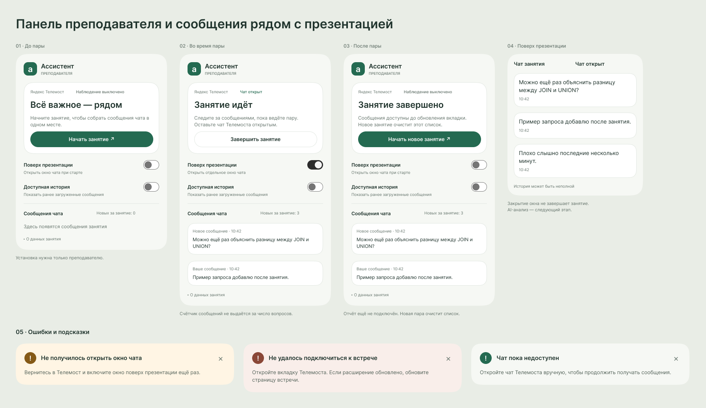
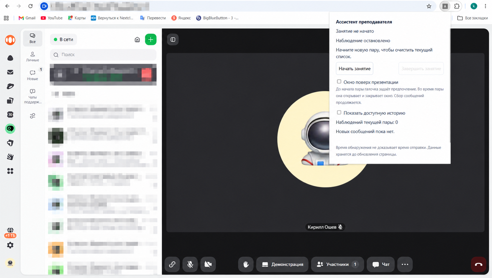
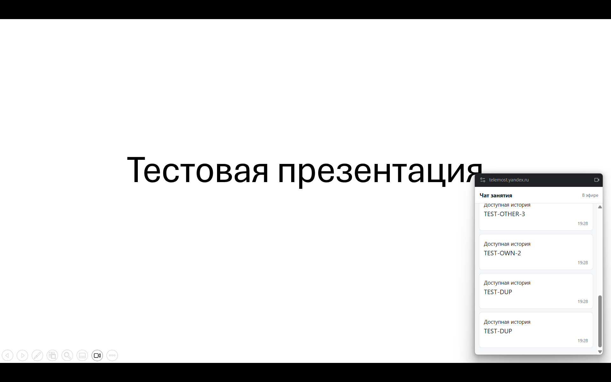

# Ассистент преподавателя для онлайн-занятий

Браузерное расширение, которое помогает преподавателю во время онлайн-занятия замечать вопросы студентов и технические проблемы, а после занятия — анализировать возникшие затруднения.

Проект выполняется в рамках проектного практикума по программе 09.03.03 «Прикладная информатика» в осеннем семестре 2026/2027 учебного года. Подробные сведения о цели, команде и критериях результата приведены в [паспорте проекта](documentation/PROJECT-PASSPORT.md).

## Проблема и идея

Во время занятия преподаватель одновременно ведёт объяснение, следит за чатом и участниками встречи. Из-за этого вопросы могут остаться незамеченными, а повторяющиеся затруднения — не получить своевременного ответа. Ассистент должен показывать наиболее значимые события в компактном виде и помогать разбирать занятие после его завершения.

## Планируемый MVP

Первая версия предназначена только для преподавателя и одной выбранной платформы онлайн-занятий. Студентам не потребуется устанавливать расширение. В целевой состав MVP входят:

- анализ доступных сообщений чата и отделение содержательных сообщений от шума;
- выделение и группировка похожих вопросов;
- обнаружение сообщений о технических проблемах и уведомления о значимых событиях;
- компактная панель преподавателя и необязательная озвучка важных уведомлений;
- итоговый отчёт с вопросами, проблемными темами, временными отметками и ручными метками преподавателя;
- оценка присутствия участников, если выбранная платформа предоставляет для этого достаточно надёжные данные.

Состав отчёта и точность показателей будут уточняться после проверки доступности данных. AI-выжимка занятия рассматривается как целевая функция MVP; она должна опираться на реально собранные данные.

## Работа с данными

Подробная схема сбора, нормализации, передачи на анализ и отображения данных описана в [схеме обработки данных](documentation/DATA-FLOW.md).

## Текущее состояние

Реализован каркас расширения Chrome для Яндекс Телемоста. Преподаватель управляет занятием через popup расширения; после начала занятия расширение открывает чат Телемоста и наблюдает доступные сообщения. При необходимости чат можно показать в отдельном небольшом окне поверх презентации. Переключатели окна и доступной истории работают независимо.

Сообщения обрабатываются локально. Парсер различает собственные сообщения по признаку строки и осторожно сопоставляет строки после повторного открытия чата. Два одинаковых текста могут быть разными сообщениями. Доступная история не гарантирует полноту переписки и принадлежность строк конкретной прошлой встрече. Имя автора, устойчивые идентификаторы участников и точная посещаемость пока не подтверждены. Итоговый отчёт ещё не реализован.

Подготовлен типизированный контракт интеграции с анализатором в `src/analysis.ts`: нормализация новых сообщений после старта, локальная сессия, фиксация пакета и проверка ответа с привязкой к исходным сообщениям. Модель и сервер пока не подключены; данные остаются в памяти вкладки. Для разработки интеграции content script отдаёт локальный снимок нормализованных событий по команде `teacher-analysis-snapshot`.

Добавлен локальный прототип сервиса анализа в `server/index.ts`. Он принимает `POST /v1/analyze` по адресу `127.0.0.1:8787`, ограничивает размер пакета, отправляет его в локальную Ollama через JSON Schema и проверяет ссылки в ответе. Для пробного запуска нужны установленная Ollama и загруженная модель `qwen3.5:9b-q4_K_M`:

```sh
npm run server:build
npm run server:start
```

Для уже скачанной локальной `freehuntx/qwen3-coder:8b` вместо `npm run server:start` используйте `npm run server:start:local-qwen`. Это временная модель для проверки интеграции; выбранная для пилота Qwen3.5 9B пока оценивается отдельно.

В другом терминале после запуска сервиса выполните `npm run check:local-flow`. Команда отправит три искусственных сообщения через API, проверит классификацию технической проблемы и объединение двух похожих вопросов, затем рассчитает пятиминутную сводку. Это проверка интеграции без реальной встречи Телемоста; её результат не заменяет испытание расширения в браузере.

Адрес модели можно задать через `OLLAMA_URL`, тег через `ANALYSIS_MODEL`. Порт сервиса можно изменить через `ANALYSIS_PORT`, но текущая сборка расширения обращается к `127.0.0.1:8787`, поэтому для совместной работы оставьте порт 8787. Сервис слушает только loopback. После запуска сервиса преподаватель может нажать «Анализировать новые сообщения» в popup: расширение отправит только накопленные после старта реплики на локальный адрес и покажет сводные вопросы, пятиминутные интервалы и технические проблемы. Пакет ограничен 50 сообщениями и примерно 12 тысячами символов; остаток остаётся в очереди. При ошибке пакет возвращается в очередь для повторной отправки. Без модели можно проверить локальный контракт командой `npm run check:offline`.

Для размещения на сервере вуза ещё нужны аутентификация, защищённый сетевой доступ и настройка адреса. Автоматический анализ раз в пять минут и итоговый отчёт пока не подключены. Редактирование уже замеченных сообщений зависит от устойчивой идентификации строки в адаптере Телемоста и тоже ещё не готово.

Интерфейс popup и окна чата оформлен для первой итерации. Посмотреть [редактируемый макет в Figma](https://www.figma.com/design/MpXXCTtNm3ftGmr1Kb2XXw?node-id=3-166) можно до установки; локальный интерактивный просмотр и сборка описаны ниже.

### Быстрый запуск

Требуется Node.js 22 LTS или новее и Chrome с поддержкой расширений Manifest V3. Для окна поверх презентации нужен Document Picture-in-Picture; если он недоступен, сообщения можно читать в popup. Зависимости сборки устанавливаются через npm.

```sh
npm ci
npm run typecheck
npm run build
```

1. Откройте `chrome://extensions`, включите режим разработчика и выберите «Загрузить распакованное расширение» → папку `dist`.
2. Откройте тестовую встречу на `https://telemost.yandex.ru/`. После обновления расширения обновите страницу встречи.
3. Нажмите значок расширения. При необходимости включите «Поверх презентации» и нажмите «Начать занятие».
4. Оставьте чат Телемоста открытым и отправьте тестовое сообщение. Стартовые и восстановленные строки смотрите отдельно через «Доступная история»; они не увеличивают счётчик новых сообщений.
5. Нажмите «Завершить занятие». Просмотр сохраняется до обновления страницы; начало новой пары очищает список.

### Посмотреть дизайн без установки расширения

```sh
npm run preview:build
```

Откройте `dist-preview/index.html` в браузере. Это самостоятельный интерактивный макет с тестовыми сообщениями и теми же компонентами, что используются в расширении. Можно переключать состояния, включать историю, менять настройку окна, начинать и завершать занятие и добавлять тестовые сообщения. Макет не подключается к Телемосту и не запускает AI. Его данные существуют только до перезагрузки страницы.

Ошибки открытия окна, подключения к встрече и доступности чата показаны закрываемыми уведомлениями по макету. Повторный опрос не открывает закрытое предупреждение, пока причина не исчезнет и не возникнет снова. Сценарии ошибок также доступны на странице просмотра.

Решения по экранам, ограничения и сценарии проверки описаны в [заметках по дизайну](documentation/DESIGN.md).

## Как устроен проект

| Часть | Назначение |
| --- | --- |
| `src/adapter.ts` | Чтение доступных сообщений из интерфейса Телемоста |
| `src/analysis.ts` | Контракт анализа, очередь сообщений и проверка ответа |
| `server/index.ts` | Локальный HTTP-сервис и вызов Ollama |
| `src/content.ts` | Состояние занятия и команды расширения |
| `src/popup.ts`, `src/view.ts`, `src/styles.ts` | Управление занятием и интерфейс popup |
| `src/pip-view.ts`, `src/pip-styles.ts` | Чат в отдельном окне |
| `src/notice.ts` | Закрываемые уведомления об ошибках |
| `preview/` | Интерактивный просмотр дизайна на тестовых данных |
| `scripts/` | Сборка расширения и макета |

## Работа в GitHub

Изменения делаем в отдельных ветках и предлагаем через pull request. В описании указываем связанную задачу, что изменилось и как проверено. Для интерфейса прикладываю превью. Перед работой смотрим открытые PR и ветки команды, чтобы не дублировать изменения. В `main` напрямую не отправляем.

## Скриншоты

Макет первой итерации в Figma (демонстрация):



Ниже — исходный каркас до обновления дизайна. Интерактивный просмотр нового интерфейса доступен через `npm run preview:build`.

Popup расширения в тестовой встрече Телемоста (адрес встречи и список чатов скрыты):



Окно чата поверх тестовой презентации:



## Команда

Все участники учатся в группе РИ-250921.

| Участник | Основные роли |
| --- | --- |
| Ошев Кирилл Александрович | Руководитель команды, fullstack-разработчик |
| Попова Наина Александровна | Дизайнер, бизнес-аналитик, frontend-разработчик |
| Бармин Егор Сергеевич | ML-инженер, backend-разработчик, аналитик данных |

Задачи системного и продуктового анализа распределяются внутри команды по мере необходимости.

## Документы

- [Паспорт проекта](documentation/PROJECT-PASSPORT.md)
- [Схема обработки данных](documentation/DATA-FLOW.md)
- [Выбор модели и требования к серверу](documentation/MODEL-SELECTION.md)
- [Бизнес-анализ](documentation/BUSINESS-ANALYSIS.md)
- [Опрос преподавателей](documentation/TEACHER-SURVEY.md)
- [Дизайн и проверка интерфейса](documentation/DESIGN.md)
